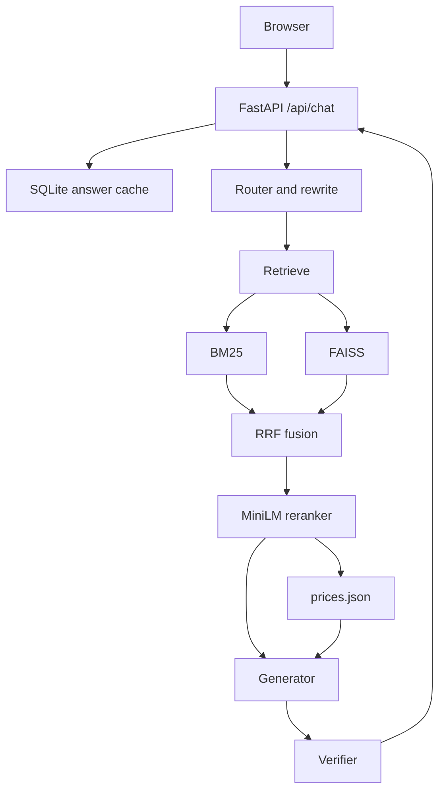

# PlacidWay assistant

A website chatbot that answers only from seven PlacidWay pages about ITC Immunity Therapy Center in Tijuana. It quotes listed prices, package inclusions, and comparison rows, and it refuses anything those pages do not say.

Live site: LIVE_URL

**Live demo:** https://137-184-131-54.sslip.io

## Architecture
|




One chat turn rewrites the question, retrieves passages, asks the generator to answer from those passages and price records, then checks the draft. A failed check is retried once. Eval sessions skip the cache.

## Design choices

Python and FastAPI keep the app in one process: HTTP, retrieval, and the verifier share the same objects, and uvicorn reloads the process while developing.

BM25 plus FAISS, fused with reciprocal rank fusion, catches both exact prices and paraphrases. BM25 holds onto "$18,995" and clinic names. FAISS, using BAAI/bge-small-en-v1.5, finds the same fact when the wording changes. The query uses the bge prefix "Represent this sentence for searching relevant passages:"; passages are embedded without it. Vectors are normalized and searched with inner product.

The reranker is Xenova/ms-marco-MiniLM-L-6-v2. It is small enough to run on CPU through fastembed, and a sigmoid plus a threshold drops weak matches instead of answering from them.

Prices live in structured `prices.json`, not only in prose. Each record has amount, currency, qualifier, program, and source URL. The verifier can require a qualifier and both program prices without parsing a paragraph.

The verifier rejects prices, clinics, and clinical claims that the retrieved pages do not support. The model drafts; the checker decides.

Generation uses Cerebras `gpt-oss-120b`. Routing and rewriting use Cerebras `qwen-3.8-27b` in one call. If Cerebras is unavailable or over its request limit, generation falls back to Groq `openai/gpt-oss-120b`, and the router falls back to Groq `openai/gpt-oss-20b`.

## Setup

Python 3.11. From the repo root:

```powershell
python -m venv .venv
.\.venv\Scripts\python.exe -m pip install -r requirements.txt
copy .env.example .env
```

Fill in `.env`. The keys are listed below. Then build the index (commands in the next section) and start the app behind Caddy:

```powershell
.\.venv\Scripts\python.exe -m uvicorn app.main:app --host 127.0.0.1 --port 8000 --proxy-headers --forwarded-allow-ips 127.0.0.1
```

`--proxy-headers --forwarded-allow-ips 127.0.0.1` makes uvicorn trust `X-Forwarded-For` from Caddy on localhost, so the per-IP rate limit sees the visitor instead of 127.0.0.1. The app also reads that header when the direct peer is localhost.

## Ingestion and refresh

Ingestion fetches only the seven allowlisted URLs, extracts sections, writes price records, chunks the pages, and builds a versioned BM25 + FAISS index. `data/index/current` points at the new version.

From scratch, in the repo root:

```powershell
.\.venv\Scripts\python.exe -m ingest.fetch
.\.venv\Scripts\python.exe -m ingest.extract
.\.venv\Scripts\python.exe -m ingest.prices
.\.venv\Scripts\python.exe -m ingest.build_index
.\.venv\Scripts\python.exe -m ingest.quality_report
```

`build_index` also writes the chunks. `quality_report` writes `data/quality_report.md`.

`POST /admin/refresh` with header `X-Admin-Token` set to `ADMIN_TOKEN` runs that same fetch, extract, prices, and index build, and returns which page hashes changed. The running process keeps the index it loaded until it restarts.

## Guardrails

- Answers come from the seven pages plus the quote URL. Other URLs are rejected.
- Every price in an answer must appear in a retrieved passage or price record, with its qualifier when the record has one.
- A treatment cost question must list each Out-Patient and In-Patient price for that package.
- Clinical claims, including colostomy, must start with "According to the clinic's page," and end with "Please discuss this with your doctor." They are not joined to the personal-safety template.
- Personal medical questions that the pages do not answer use a fixed template and do not diagnose.
- Booking, weather, and other off-topic questions use fixed replies.
- Public chat is limited to 10 requests a minute per client IP and 1,500 questions a day.
- Admin routes require `X-Admin-Token`.
- The answer cache key includes `CACHE_VERSION`, so a new commit does not serve an old answer. Session ids that start with `eval-` skip the cache.

## Tests and evals

```powershell
.\.venv\Scripts\python.exe -m pytest
.\.venv\Scripts\python.exe -m evals.run_evals --required
.\.venv\Scripts\python.exe -m evals.run_evals
```

`--required` runs the required questions and writes `test_results.md`: those questions with the full answer and sources, then the table for the run. The server must already be listening on port 8000. Eval sessions are not cached.

## Environment

Copy `.env.example` to `.env`. Every key there is empty; set the ones you use.

| Key | Role |
|---|---|
| `LLM_PROVIDER` | Provider name kept in settings |
| `GROQ_API_KEY` | Groq key for fallback |
| `GROQ_MODEL` | Groq generation model |
| `CEREBRAS_API_KEY` | Cerebras key for the router and generator |
| `CEREBRAS_MODEL` | Optional Cerebras model override |
| `ROUTER_MODEL` | Router and rewrite model |
| `GEN_MODEL` | Generation model |
| `GEN_FALLBACK_MODEL` | Cerebras model used when the generation quota is empty |
| `RERANK_MODEL` | Reranker id recorded at index build |
| `RERANK_THRESHOLD` | Minimum rerank score |
| `TOP_K` | Passages sent to the generator |
| `ADMIN_TOKEN` | Secret for `/admin/refresh` |
| `QUOTE_URL` | Free-quote link appended to some replies |
| `DB_PATH` | SQLite file for logs and the answer cache |
| `CACHE_VERSION` | Cache-key stamp. Empty means the short git commit hash |

Limitations are in [WRITEUP.md](WRITEUP.md).
